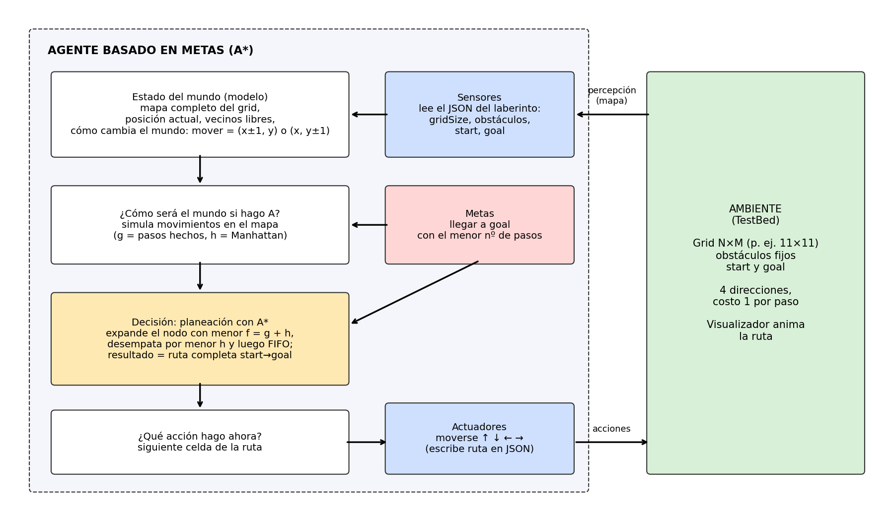

# Desafío 2 — Agente con A* (heurística Manhattan)

**Matrícula:** A01286661

## 0. Descripción del problema

El agente vive en un laberinto de **N × M** celdas y debe ir de `start` a `goal`. Los laberintos asignados son tres: **Fácil (8 × 8, 10 obstáculos)**, **Medio (15 × 15, 43 obstáculos)** y **Difícil (25 × 25, 179 obstáculos)**, todos de `(0,0)` a la esquina opuesta.
A diferencia del robotito del Desafío 1, **conoce el mapa completo antes de moverse**: lo recibe en el JSON que se descarga del TestBed.
Con ese mapa **planea** la ruta más corta con A\* y después la entrega como una lista de celdas que el Visualizador anima.

Convención: `x` es la columna y `y` la fila, ambas desde **0**; el origen `(0,0)` está arriba a la izquierda y `y` crece hacia abajo.
(En el Desafío 1 las coordenadas iban de 1 a 5.) Movimiento en 4 direcciones, una celda por paso, costo 1.

### PEAS

| Componente | Agente A\* |
|---|---|
| **P**erformance | Llegar a `goal`; con el menor número de pasos (ruta óptima) y explorando pocos nodos / poco tiempo |
| **E**nvironment | Grid N×M con obstáculos fijos, `start` y `goal` |
| **A**ctuators | Moverse una celda arriba, abajo, izquierda o derecha (en la práctica: escribir la ruta en el JSON de resultado) |
| **S**ensors | Lectura del JSON del laberinto: tamaño, obstáculos, `start`, `goal` |

---

## 1. Ambiente: las 6 variables

| # | Variable | Clasificación | Justificación | ¿Cambió respecto al Desafío 1? |
|---|---|---|---|---|
| 1 | Observable / parcialmente observable | **Totalmente observable** | El agente recibe todo el mapa: tamaño, todos los obstáculos, su posición inicial y la meta. No hay nada relevante para decidir que no conozca. | **Sí.** El robotito solo sentía *choque* y *en meta*; no sabía dónde estaba ni dónde estaban los obstáculos → parcialmente observable. |
| 2 | Determinista / estocástico | **Determinista** | Moverse a una celda libre siempre lleva a esa celda. Además el agente tampoco tiene aleatoriedad: el mismo laberinto da siempre la misma ruta. | El ambiente ya era determinista, pero el robotito elegía al azar al chocar, así que el sistema completo se comportaba de forma estocástica. Ahora **todo** es determinista. |
| 3 | Episódico / secuencial | **Secuencial** | Cada movimiento cambia la posición y condiciona los siguientes; la ruta es una secuencia de decisiones. A\* lo maneja *planeando* la secuencia completa antes de actuar. | No cambió. Lo que cambió es que el robotito decidía *como si* fuera episódico (sin memoria) y A\* sí razona sobre la secuencia. |
| 4 | Estático / dinámico | **Estático** | Los obstáculos y la meta no se mueven mientras el agente planea ni mientras ejecuta. Esto es lo que permite planear una sola vez y seguir el plan sin re-planear. | No cambió. |
| 5 | Discreto / continuo | **Discreto** | Número finito de celdas (de 64 en el Fácil a 625 en el Difícil), 4 acciones, tiempo en pasos. | No cambió (solo el tamaño: de 5×5 a 8×8, 15×15, 25×25 o cualquier N×M). |
| 6 | Un agente / multiagente | **Un agente** | Solo hay un agente en el laberinto; los obstáculos no actúan. | No cambió. |

Extra: el ambiente es **conocido** (el agente conoce las reglas *y* el mapa). En el Desafío 1 era **desconocido**.

**¿Qué cambió y por qué?** Cambiaron **la observabilidad** (de parcial a total) y el **conocimiento del ambiente** (de desconocido a conocido) porque ahora el agente recibe el mapa entero de antemano. Como consecuencia indirecta, el comportamiento del sistema pasa de estocástico a determinista: el agente ya no necesita elegir al azar para "salir" de un choque, porque puede calcular de antemano cómo rodear cada obstáculo.

---

## 2. Percepciones

**Qué recibe:** una sola percepción, al inicio, con todo el mapa:

```json
{ "gridSize": {"x": 11, "y": 11}, "obstaculos": [{"x": 2, "y": 3}, ...],
  "start": {"x": 0, "y": 0}, "goal": {"x": 10, "y": 10} }
```

(`recolectables` se ignora en este desafío.)

**Cuándo:** antes de dar el primer paso. El agente lee el JSON, construye su modelo del mundo (conjunto de obstáculos + función `vecinos(p)` que devuelve las celdas libres adyacentes), planea toda la ruta con A\* y **luego** actúa. Como el ambiente es estático y determinista, no necesita volver a percibir durante la ejecución: sabe que cada movimiento lo lleva exactamente a la celda planeada.

**Qué sabe que el robotito no sabía:**

| Información | Robotito (D1) | Agente A\* (D2) |
|---|---|---|
| Su posición `(x, y)` | No | Sí |
| Dónde está la meta | No (solo "ya llegué / no") | Sí |
| Dónde están los obstáculos | No (los descubre al chocar) | Sí, todos, antes de moverse |
| Tamaño del grid / bordes | No (los descubre al chocar) | Sí |
| Distancia a la meta | No | Sí (Manhattan, la usa como heurística) |
| Si existe ruta | Nunca lo sabe (se mueve para siempre) | Sí: si la lista abierta se vacía, no hay ruta |

---

## 3. Tipo de agente y diagrama

### Tipo: **agente basado en metas** (*goal-based agent*) que planea

- **Tiene modelo del mundo:** el mapa y cómo cambia la posición con cada acción. Eso ya lo haría un agente reactivo basado en modelo…
- …pero además **tiene una meta explícita** (`goal`) y **decide considerando el futuro**: simula secuencias de acciones ("¿cómo será el mundo si hago A?") y elige la que lo lleva a la meta. Esa es la característica de un agente basado en metas.
- No es un agente basado en **utilidad** en sentido estricto porque la medida es binaria (llegar o no) con la restricción de costo mínimo; aunque se puede ver A\* como maximizar la utilidad `−pasos`. Tampoco **aprende**: todo lo que necesita viene en el mapa.

### Diagrama del agente



| Parte del diagrama | En el código (`astar.py`) |
|---|---|
| Sensores | `Laberinto.desde_json()` |
| Estado del mundo / cómo cambia | `Laberinto` (`obstaculos`, `dentro`, `libre`, `vecinos`) |
| ¿Cómo será el mundo si hago A? | Expansión de vecinos con `g + 1` y `h = manhattan(vecino, goal)` |
| Metas | `lab.goal` y la prueba `actual == goal` |
| Decisión | `a_estrella()`: lista abierta (heap) ordenada por `(f, h, orden)` |
| Actuadores | `reconstruir()` + escritura de `ruta` en el JSON de resultado |

### Detalles de implementación y desempate

- **Lista abierta:** un *heap* con tuplas `(f, h, contador, celda)`.
  1. Menor `f = g + h`.
  2. Si empatan en `f`, **menor `h`**: prefiere la celda más cercana a la meta. En un grid con costo uniforme hay *muchísimos* empates en `f`; este desempate hace que A\* "se lance" hacia la meta en vez de abrir en abanico todas las celdas con el mismo `f`, y reduce los nodos explorados.
  3. Si también empatan en `h`, **FIFO** (la que entró primero), con un contador incremental. Así el resultado es reproducible.
- **Orden de vecinos:** arriba, derecha, abajo, izquierda.
- **Lista cerrada:** un `set`. Cuando se encuentra un camino mejor a una celda que ya está en la abierta, se mete otra entrada al heap y la vieja se ignora al sacarla (si la celda ya está cerrada).
- **`nodosExplorados`:** cada celda en el orden en que se **saca** de la abierta y se cierra (incluye `start` y `goal`).
- **Prueba de meta al sacar** (no al generar), que es lo que garantiza la optimalidad.
- **`tiempoMeta`:** medido con `time.perf_counter()` solo alrededor de `a_estrella()` (no incluye leer ni escribir archivos).
- **Sin ruta:** si la abierta se vacía sin sacar `goal`, el programa imprime `*** NO EXISTE RUTA ... ***`, no escribe archivo y sale con código 1. Probado con `laberintos/sin_ruta.json` (el ejemplo con la meta encerrada).

**Por qué mis `nodosExplorados` pueden ser distintos al A\* del TestBed:** los **pasos** deben coincidir siempre (los dos son óptimos), pero cuando hay varias rutas óptimas o varios nodos con el mismo `f`, cada implementación elige según su desempate (por `h`, por orden de inserción, LIFO vs FIFO, orden de los vecinos). Eso cambia qué celdas se sacan antes de llegar a la meta, y por lo tanto la lista y el número de nodos explorados, e incluso cuál de las rutas óptimas se dibuja.

---

## 4. Heurística: por qué Manhattan es admisible

La distancia Manhattan entre la celda `n = (x, y)` y la meta `G = (x_g, y_g)` es

  h(n) = |x − x_g| + |y − y_g|

**Nunca sobreestima** el costo real `h*(n)`:

1. Cada movimiento cambia **solo una** coordenada en **exactamente 1** (no hay diagonales). Por eso cada paso reduce `|x − x_g| + |y − y_g|` en **a lo más 1**.
2. Para llegar a la meta esa suma tiene que bajar de `h(n)` a 0, así que hacen falta **al menos `h(n)` pasos**.
3. Cada paso cuesta 1, entonces cualquier ruta cuesta ≥ `h(n)`: **h(n) ≤ h\*(n)**. Los obstáculos solo pueden *alargar* el camino (obligan a rodear), nunca acortarlo, así que la desigualdad se mantiene. Si no hay obstáculos en medio, `h(n) = h*(n)` exactamente.

Además es **consistente** (monótona): para vecinos `n, n'`, `h(n) ≤ 1 + h(n')`, porque un paso cambia la Manhattan en ±1. Y `h(goal) = 0`.

**Qué garantiza:** como `h` es admisible (y consistente), **A\* encuentra la ruta más corta**: cuando saca `goal` de la lista abierta, ningún otro nodo pendiente puede llevar a una ruta más barata, porque su `f = g + h` es una cota inferior de cualquier ruta que pase por él. Con consistencia, además, cada nodo se cierra con su `g` óptimo y nunca hay que reabrirlo. Por eso mis **pasos coinciden** con los del A\*, BFS y Dijkstra de referencia. (Si la heurística sobreestimara —por ejemplo, Manhattan × 2— A\* podría devolver una ruta más larga.)

---

## 5. Experimentación

Este diseño es la base del Desafío 4, así que compara a los cuatro tipos de agente: **robotito** (reactivo, aleatorio), **A\*** (planea con mapa), **Q-learning** (aprende) y los de referencia del TestBed **BFS** y **Dijkstra**.

### 5.1 Variables

**Independientes (las que yo controlo en el ambiente):**

| Variable | Niveles propuestos | Por qué |
|---|---|---|
| Tamaño del grid | 8×8, 15×15, 25×25 (los mismos de los laberintos asignados) | Mide cómo escala cada agente (nodos explorados, tiempo, episodios de entrenamiento). |
| Densidad de obstáculos | 10 %, 20 %, 30 % de las celdas | Más obstáculos = más rodeos; afecta muchísimo al robotito y poco a A\*. |
| Distancia start–goal | corta / media / larga (Manhattan ≈ 25 %, 50 %, 100 % de `ancho+alto−2`) | Separa el efecto de "estar lejos" del efecto del tamaño. |
| *(opcional)* Tipo de obstáculos | dispersos vs. muros/pasillos | Los muros generan callejones sin salida, donde la heurística engaña más. |
| *(control)* Que exista ruta | siempre sí (se verifica con BFS al generar) | Si no, "no llegó" se mezcla con "no se podía". Se prueba aparte. |

**Dependientes (las que mido en cada corrida):**

| Variable | Definición |
|---|---|
| Éxito | ¿Llegó a la meta antes del límite de pasos? (sí/no). Tasa de éxito por condición. |
| Pasos | Movimientos de la ruta ejecutada. |
| Razón de optimalidad | `pasos / pasos_óptimos` (óptimo = BFS). 1.0 = ruta más corta. |
| Nodos explorados | Celdas sacadas de la frontera (A\*, BFS, Dijkstra). Para robotito: celdas visitadas; para Q-learning: estados visitados durante el entrenamiento. |
| Tiempo a la meta | Segundos de cómputo (planeación) — y para Q-learning también el tiempo de entrenamiento. |
| Choques | Solo robotito (y Q-learning en entrenamiento). |
| Episodios para converger | Solo Q-learning: episodios hasta que la política greedy llega con ruta óptima. |

### 5.2 ¿Cuántas corridas hacen falta?

| Agente | ¿Es aleatorio? | Repeticiones por laberinto | Justificación |
|---|---|---|---|
| A\*, BFS, Dijkstra | No: mismo laberinto → misma ruta y mismos nodos | **1** para pasos y nodos; **30** solo para el tiempo (reportar la mediana) | Repetir no cambia ni pasos ni nodos. El tiempo sí varía por el sistema operativo (otros procesos, caché), y con tiempos de microsegundos la mediana de ~30 corridas es estable. |
| Robotito | Sí: elige dirección al azar | **≥ 30**, idealmente calculado | Tiene varianza enorme (en el D1, con un solo obstáculo, los pasos fueron de 8 a 94). Con desviación estándar `s` y margen de error deseado `E` al 95 %: `n = (1.96·s / E)²`. Con un piloto de 30 corridas se estima `s` y se ajusta `n`. Ej.: `s ≈ 20` pasos y `E = 5` → `n ≈ 62`. Se fija un límite de pasos (p. ej. `4·ancho·alto`) y se cuenta como fracaso si lo alcanza. |
| Q-learning | El entrenamiento sí (exploración ε-greedy, inicialización); la política entrenada evaluada con greedy, no | **10 semillas de entrenamiento** por laberinto; cada política se evalúa **1 vez** (greedy, determinista) | La variabilidad está en el entrenamiento, así que se repite *el entrenamiento*, no la evaluación. 10 semillas permiten reportar media ± desviación y la curva de aprendizaje promedio. |

**Laberintos por condición:** un solo laberinto no basta porque el resultado depende de su forma; uso **5 laberintos distintos por condición** (generados con semilla para ser reproducibles).

**Total:** 3 tamaños × 3 densidades × 3 distancias = **27 condiciones × 5 laberintos = 135 laberintos**.
Por laberinto: 3 corridas deterministas (A\*, BFS, Dijkstra) + 30–60 de robotito + 10 entrenamientos de Q-learning → del orden de **6 000–10 000 corridas**, todas automatizables con un script.

### 5.3 Diseño del experimento

**¿Cómo serían los laberintos?**
Generados con un script con semilla fija: grid del tamaño de la condición, obstáculos colocados al azar hasta la densidad pedida, `start` y `goal` elegidos a la distancia Manhattan pedida, y **descartados** si BFS no encuentra ruta. Se guardan en el mismo formato JSON del TestBed para poder subir cualquiera al Visualizador. Aparte, un pequeño conjunto de laberintos **sin ruta** para comprobar que cada agente lo detecta (A\*/BFS/Dijkstra) o qué hace cuando no puede saberlo (robotito, Q-learning).

**¿Qué variables usaría en la comparación?**
Principalmente **tasa de éxito**, **razón de optimalidad** (`pasos/óptimo`), **nodos explorados** y **tiempo**, cada una contra tamaño, densidad y distancia. Para Q-learning, además, episodios para converger.

**Paso a paso:**

1. Fijar semillas y generar los 135 laberintos (+ los de control sin ruta); guardar los JSON.
2. Calcular la ruta óptima de cada laberinto con BFS (referencia para la razón de optimalidad).
3. Correr A\*, BFS y Dijkstra una vez cada uno (+ 30 repeticiones solo de tiempo); guardar todo en un CSV con columnas `laberinto, tamaño, densidad, distancia, agente, corrida, éxito, pasos, óptimo, nodos, tiempo`.
4. Correr el robotito un piloto de 30 veces por laberinto, estimar `s`, completar hasta `n` corridas, con límite de pasos.
5. Entrenar Q-learning con 10 semillas por laberinto (mismos hiperparámetros para todos: α, γ, ε, número máximo de episodios), evaluar cada política con greedy y guardar su curva de aprendizaje.
6. Subir una muestra de resultados al TestBed para verificar que las rutas son válidas y comparar visualmente contra la referencia.
7. Analizar: tablas de medias ± desviación por condición, gráficas (nodos vs. tamaño, éxito vs. densidad, etc.) y una prueba estadística (p. ej. Wilcoxon/Kruskal-Wallis, porque los pasos del robotito no son normales) para ver si las diferencias son significativas.
8. Concluir qué agente conviene según el ambiente (¿cuándo vale la pena conocer el mapa? ¿cuándo aprender?).

### 5.4 Primera comparación real (TestBed)

Corrí mi A\* en los tres laberintos asignados (`resultados/laberinto_*_astar.json`) y lo comparé contra el A\*, BFS y Dijkstra de referencia en el Visualizador del TestBed.

**Mi A\*** (salida de `astar.py`, `tiempoMeta` de esa corrida):

| Laberinto | Tamaño | Obstáculos | Pasos | Nodos explorados | Tiempo (s) |
|---|---|---|---|---|---|
| Fácil | 8×8 | 10 | 14 | 20 | 0.000069 |
| Medio | 15×15 | 43 | 28 | 68 | 0.000232 |
| Difícil | 25×25 | 179 | 48 | 132 | 0.000482 |

En los tres casos los pasos son iguales a la distancia Manhattan entre `start` y `goal` (7+7, 14+14, 24+24): existe una ruta "en escalera" que nunca se aleja de la meta, así que la heurística es exacta en `start` y la ruta encontrada es la mínima posible.

**Referencia del TestBed** — *completar con los números del Visualizador:*

| Laberinto | Algoritmo | Pasos | Nodos explorados | Tiempo (s) |
|---|---|---|---|---|
| Fácil | A\* (referencia) | | | |
| Fácil | BFS (referencia) | | | |
| Fácil | Dijkstra (referencia) | | | |
| Medio | A\* (referencia) | | | |
| Medio | BFS (referencia) | | | |
| Medio | Dijkstra (referencia) | | | |
| Difícil | A\* (referencia) | | | |
| Difícil | BFS (referencia) | | | |
| Difícil | Dijkstra (referencia) | | | |

*Screenshot del Visualizador:* ``

**Comparación local** (`python comparar.py laberintos/laberinto_*.json`; mismas máquina e implementación para los tres algoritmos, tiempo = mediana de 50 corridas):

| Laberinto | Algoritmo | Pasos | Nodos explorados | Tiempo (ms) |
|---|---|---|---|---|
| Fácil (8×8) | A\* | 14 | **20** | **0.053** |
| Fácil (8×8) | BFS | 14 | 54 | 0.096 |
| Fácil (8×8) | Dijkstra | 14 | 54 | 0.121 |
| Medio (15×15) | A\* | 28 | **68** | **0.192** |
| Medio (15×15) | BFS | 28 | 181 | 0.331 |
| Medio (15×15) | Dijkstra | 28 | 181 | 0.425 |
| Difícil (25×25) | A\* | 48 | **132** | **0.385** |
| Difícil (25×25) | BFS | 48 | 430 | 0.793 |
| Difícil (25×25) | Dijkstra | 48 | 430 | 1.009 |

Caso sin ruta (`laberintos/sin_ruta.json`, 11×11 con la meta encerrada): los tres exploran las mismas **74** celdas alcanzables y reportan que no hay ruta.

**Explicación de las diferencias:**

- **Pasos iguales** en los tres: todos son óptimos con costo uniforme. BFS lo es porque explora por niveles (todas las celdas a distancia 1, luego 2…) y con costo 1 "nivel" = costo; Dijkstra porque expande por costo acumulado `g`; A\* porque su heurística es admisible.
- **BFS y Dijkstra exploran casi lo mismo:** con todos los costos iguales a 1, Dijkstra ordena por `g`, que es exactamente el nivel de BFS. Son búsquedas *ciegas*: se expanden en "círculos" (rombos, en Manhattan) alrededor de `start` sin saber hacia dónde está la meta. Dijkstra suele tardar un poco más por el heap (`O(log n)` por operación) contra la cola simple de BFS (`O(1)`).
- **A\* explora menos:** 20 vs. 54 (Fácil), 68 vs. 181 (Medio) y 132 vs. 430 (Difícil), entre 62 % y 69 % menos nodos, y la ventaja crece en números absolutos con el tamaño del grid (BFS/Dijkstra exploran casi todo el laberinto antes de llegar a la esquina opuesta). Esto es porque `h` lo orienta hacia la meta: solo expande nodos con `f ≤ costo óptimo`, y el desempate por menor `h` hace que entre los empates avance primero hacia `goal`.
- **El tiempo** sigue a los nodos explorados: A\* tarda alrededor de la mitad que BFS y menos de la mitad que Dijkstra en los tres laberintos. Aun así son fracciones de milisegundo y el tiempo está dominado por el sistema (por eso se repite y se usa la mediana). Calcular `h` le agrega un poco de costo por nodo a A\*.
- **Sin ruta, A\* no tiene ventaja:** para demostrar que no hay ruta los tres tienen que agotar *todas* las celdas alcanzables (74), así que exploran lo mismo.

---

## 6. Reflexión

### ¿A\* resuelve lo que propuse en el Desafío 1?

Sí. En el D1 propuse, en orden: (1) sensores que vieran los obstáculos antes de chocar, (2) memoria/mapa interno, (3) conocer la meta y preferir direcciones que reduzcan la **distancia Manhattan**, y (4) **planear la ruta más corta con BFS o A\*** sobre el mapa. A\* es exactamente el punto 4 y ya incluye los anteriores: tiene el mapa (no choca nunca), recuerda qué celdas ya cerró (no da vueltas en círculos) y usa la distancia Manhattan para ir hacia la meta. Además resuelve el caso que el robotito no podía: **detecta cuando la meta es inalcanzable** en lugar de moverse para siempre.

**Qué información necesita A\* que el robotito no tenía:** su posición, la posición de la meta, la ubicación de *todos* los obstáculos, el tamaño del grid y el modelo de transición (qué celda resulta de cada acción). El robotito solo tenía dos bits: `choque` y `en_meta`.

### ¿Y si el agente no conociera el mapa?

El ambiente pasaría a ser parcialmente observable y desconocido, y no se podría planear la ruta completa al inicio. Opciones:

- **Planear con lo que sabe y re-planear (D\* Lite / A\* incremental):** suponer que lo desconocido está libre (*free-space assumption*), calcular A\* sobre ese mapa optimista, avanzar con sensores de proximidad que detecten las celdas vecinas, y **re-planear** cada vez que descubra un obstáculo en su ruta. Va construyendo el mapa mientras se mueve.
- **Aprender por refuerzo (Q-learning):** sin modelo, el agente prueba acciones y recibe recompensas (p. ej. −1 por paso, −10 por chocar, +100 al llegar). Va actualizando una tabla `Q(estado, acción)` con  
  `Q(s,a) ← Q(s,a) + α [ r + γ·max_a' Q(s',a') − Q(s,a) ]`  
  y tras muchos episodios la política greedy sigue la ruta más corta. Necesita muchos episodios de entrenamiento y solo sirve para *ese* laberinto (si cambia el mapa hay que reentrenar), pero no necesita conocer el mapa ni la meta de antemano.

Lo que cambiaría en el código: el agente ya no lee los obstáculos del JSON sino que los **percibe** al moverse (el ambiente le responde con su nueva posición, si chocó y una recompensa), y el estado del agente incluye su mapa parcial o su tabla Q.

### ¿Varios agentes, cada uno con su meta, en el mismo laberinto?

El ambiente se vuelve **multiagente** y **dinámico** (para cada agente, los otros son obstáculos que se mueven). Habría que modificar:

- **Representación:** una lista de agentes, cada uno con su `start`, `goal`, posición y ruta; y el tiempo explícito (paso `t`).
- **Planeación con tiempo:** buscar en el espacio `(x, y, t)` en lugar de `(x, y)`, agregando la acción **esperar**, y con una **tabla de reservaciones** (`(x, y, t)` ocupada por el agente *k*) para que los planes no choquen. Esto es *Cooperative A\** / *prioritized planning*. Si se quiere el óptimo conjunto: *Conflict-Based Search (CBS)*.
- **Conflictos a detectar:** dos agentes en la misma celda al mismo tiempo (*vertex conflict*) y dos agentes que intercambian celdas en el mismo paso (*swap / edge conflict*).
- **Salida:** una ruta por agente, todas de la misma duración (rellenando con "esperar" al final) para poder animarlas juntas.

### ¿Cómo deciden quién pasa primero?

- **Prioridades fijas:** cada agente tiene un orden (ID, o el que tiene la ruta más larga/la meta más lejana va primero). El de mayor prioridad planea primero y reserva sus celdas; los demás planean respetando esas reservas (esperan o rodean). Simple y rápido, pero no siempre óptimo y puede dejar a alguien sin ruta.
- **Reglas de tráfico locales:** si dos agentes van a chocar, cede el que tenga menor prioridad o, como en tráfico, "el de la derecha pasa primero"; el otro espera un paso o se hace a un lado.
- **Negociación / CBS:** cuando se detecta un conflicto, se prueban las dos alternativas (que espere A o que espere B) y se elige la que da menor costo total. Es la opción óptima pero más cara de calcular.
- **Prioridad dinámica:** sube la prioridad del agente que lleva más tiempo esperando, para evitar que uno se quede bloqueado indefinidamente (*starvation*), o se rompe el empate al azar para evitar bloqueos mutuos (*deadlock*).
